# Realm-Creative-Labs
Official Realm Creative Labs portfolio showcasing my software, AI assistants, games, digital tools and creative projects.

# 🚀 Realm Creative Labs

### Software • Artificial Intelligence • Gaming • Digital Innovation

Welcome to **Realm Creative Labs**, an independent development studio creating software, AI-powered tools, games and digital experiences.

This GitHub portfolio showcases our projects, progress and future development.

## 💻 Our Projects

## Realm DVD Creator

**Status: In Development**

Realm DVD Creator is an offline-first Windows desktop application for preparing DVD-Video projects, calculating disc capacity, designing navigation menus and producing validated DVD-Video output from user-owned, unprotected media.

### Implemented

- PAL DVD-Video conversion, menu authoring, `VIDEO_TS` generation, ISO creation, validation, IMAPI2 burning and finalisation.
- Smart Disc Fit planning with per-title bitrate allocation, capacity checks and multi-movie DVD collections.
- Menu Designer Pro with a resizable three-panel workspace, direct drag/resize editing, editable button text and styling, stock or custom backgrounds, animated backgrounds, safe-area guides, Undo/Redo and preview/test mode.
- Working chapter, audio and subtitle menu generation with automatic pagination and PAL-safe highlight validation.
- Configurable ISO, authored-project and temporary-workspace destinations, disk-space checks, no-overwrite protection and safe application-owned workspace cleanup.
- Local movie, chapter, audio and subtitle inspection using bundled media tools; processing remains offline by default.
- Staged build progress, diagnostics and verification gates that keep Burn unavailable until the authored output and ISO pass validation.
- Consent-based update checks and verified local update-package staging; private-repository credentials are not stored in the application.

### Testing status

The current development checkpoint passes 83 core regression checks. Synthetic-media integration has exercised application startup, media probing, custom and animated menu rendering, chapter/audio/subtitle pagination, PAL button bounds, Smart Disc Fit, multi-movie authoring, `VIDEO_TS`, ISO creation and ISO validation. Menu artwork and edit/preview states shown below were captured from the installed Windows application using synthetic or project-owned assets.

An earlier tested Realm DVD Creator build successfully burned and finalised a physical DVD+R. That disc played in VLC, on a separate standalone DVD player and on a disc-equipped PlayStation 5; PS5 menu and chapter navigation also passed. These are preserved historical hardware-acceptance results, not a claim that every later maintenance build or every player/media combination has been retested. The newer automatic movie-title volume label still requires a fresh physical burn/eject/reinsert check in Windows File Explorer.

The source code remains in a private repository while development and acceptance testing continue. The primary development workspace has moved to a dedicated development drive, while installed software and large DVD output use separate locations. This public repository contains showcase documentation and approved screenshots only; it does not publish source code, user media, diagnostic logs or private paths.

**Public Release Date: TBA — Not Yet Announced**

### Screenshots

| Dashboard | Smart Disc Fit |
| --- | --- |
| 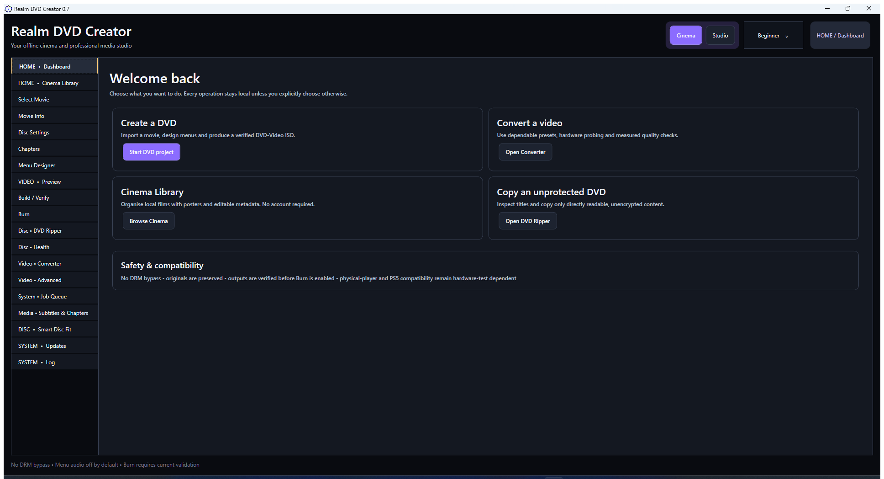 | 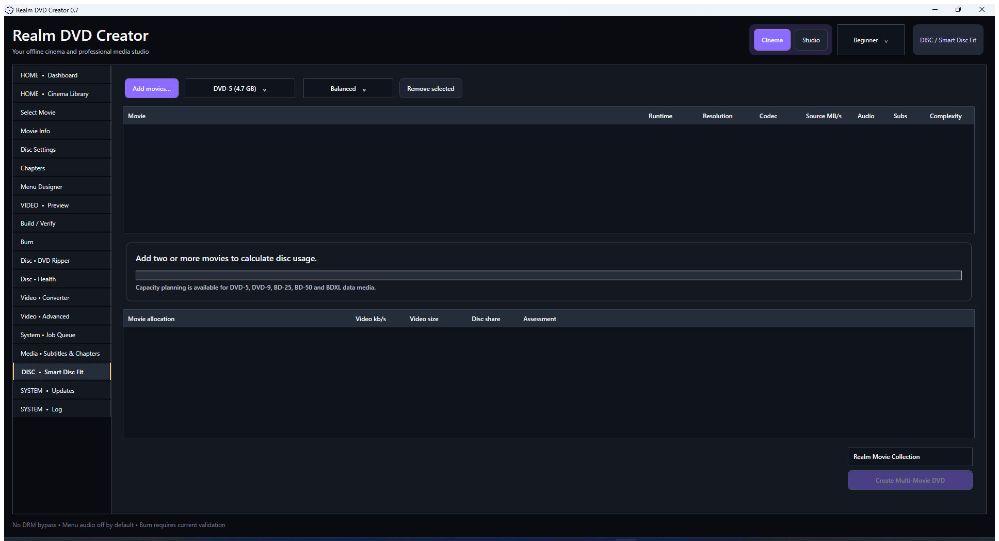 |

| Multi-movie DVD workflow | Custom menu background |
| --- | --- |
| 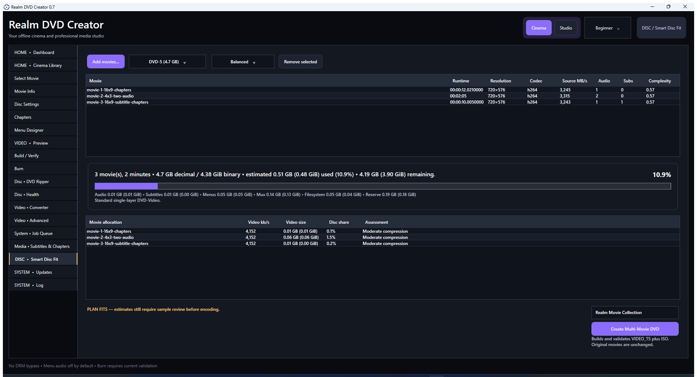 | 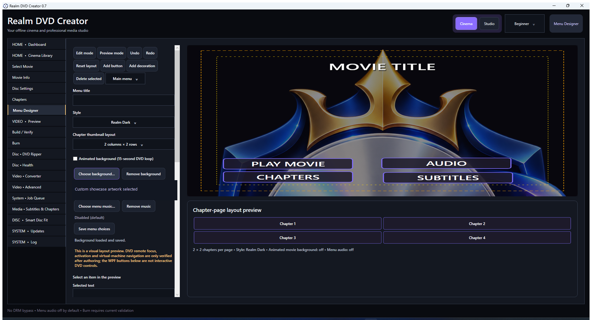 |

| Drag-and-drop edit mode | Menu preview mode |
| --- | --- |
| 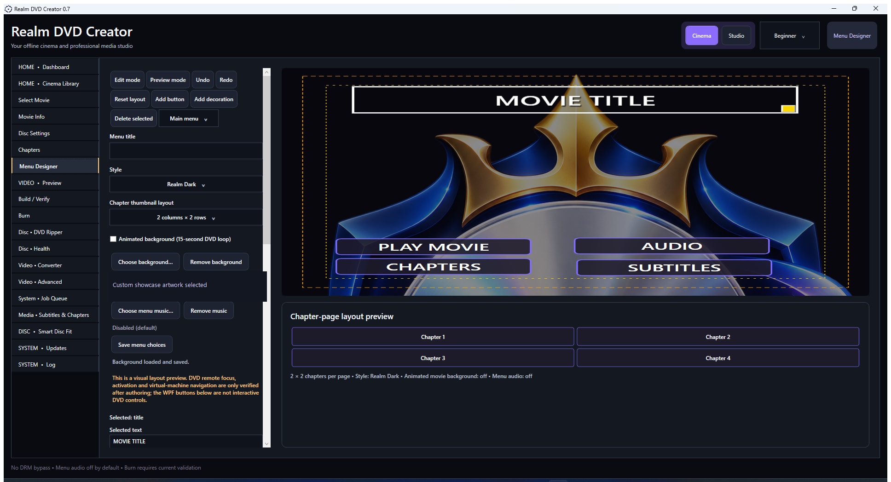 | 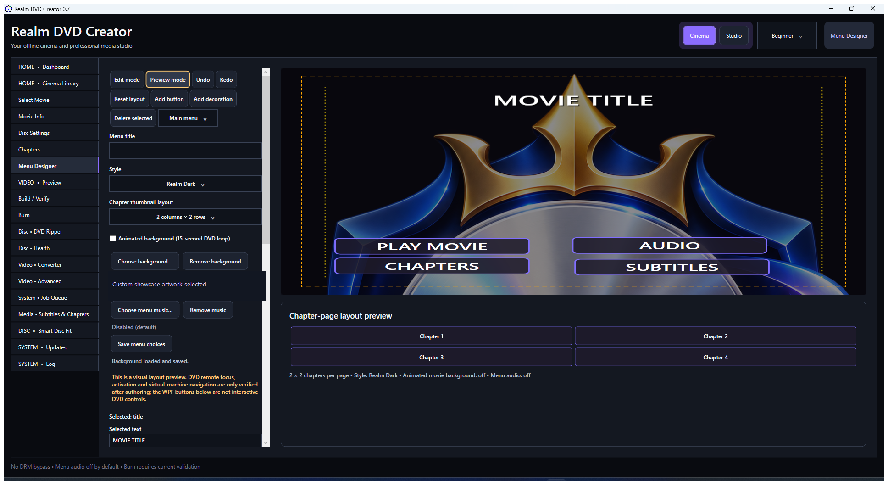 |

| Updates | Build and Verify |
| --- | --- |
| 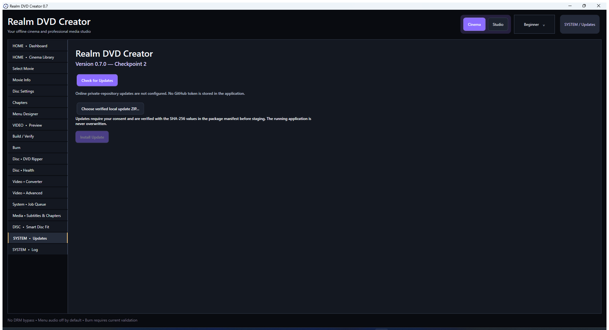 | 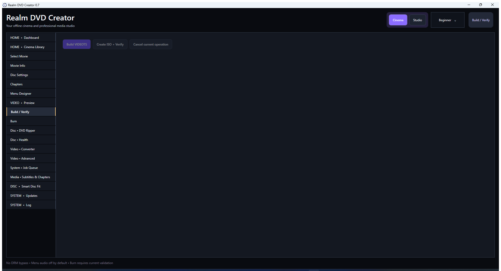 |

## REALM HUB

### *Your PC. Your Software. Your Realm.*

**Status: v0.2.0 IN DEVELOPMENT**

Realm Hub is a native Windows desktop application designed as the central home for Realm Creative Labs software and live PC health information. It combines a privacy-conscious application launcher, responsive hardware monitoring, desktop widgets, system-tray controls and persistent visual personalisation in one dashboard.

### Current development features

- Combined PC-health dashboard with real CPU, GPU, RAM, VRAM, disk, network and uptime readings where Windows and the hardware expose them.
- Bounded live CPU, GPU, memory, network and disk history graphs with session peaks.
- CPU/GPU temperatures, storage information and fan readings where supported; unavailable sensors are clearly labelled rather than simulated.
- Realm application catalogue with genuine installed-state detection, custom executable locations and launch support.
- Compact, Standard and Advanced desktop-widget layouts backed by the same shared monitoring service.
- Windows system-tray integration, minimise-to-tray behavior and single-instance window restoration.
- Realm Neon, Realm Professional, Realm Cyber, Realm Carbon and Realm Minimal themes.
- Persistent application-tile ordering, favourites, dashboard section visibility and named dashboard layouts.
- Local settings with no account requirement, telemetry or cloud upload by default.
- Built-in Realm PC Suite with guarded Smart Cleaner, read-only Windows diagnostics, genuine installed-driver inventory, reversible startup management, storage reporting and measured network diagnostics.
- Responsive Smart Cleaner with protected locations, cancellation, 250-row virtualised pages, full file review and explicit confirmation before any supported cache file can be removed.
- Theme-aware tables and dialogs with readable headers, rows, selection and long-path inspection in Realm Neon, Realm Carbon and Realm Professional.

### v0.2.0 verified progress

The v0.2.0 private-development checkpoint passed a clean Windows Release build and 24/24 automated acceptance tests. Real isolated desktop acceptance exercised a 20,000-file disposable Smart Cleaner scan, active cancellation, one-click selection, Select All/None, full review, exact deletion of one disposable test file and safe handling of a deliberately locked disposable file. The same acceptance session read genuine Windows driver inventory, ran read-only Windows Update/Event Log diagnostics and refreshed mounted-drive capacity without the previous Storage binding error.

Unsupported CPU temperature, fan and storage-health sensors remain labelled **Not available** when the normal non-elevated provider cannot supply them. Administrator repairs, driver installation, router changes and cleaning of real user files were not performed. ASTRA remains disconnected with zero action authority. The currently installed build has not been replaced by v0.2.0.

Realm Hub remains in active private development. Major dashboard-section reordering, resizable dashboard cards, complete custom-theme management and additional hardware/configuration acceptance tests are still being completed. Its private source code is not published in this showcase.

**Public Release Date: TBA — Not Yet Announced**

### Screenshots

| Combined dashboard | Live PC monitor |
| --- | --- |
| 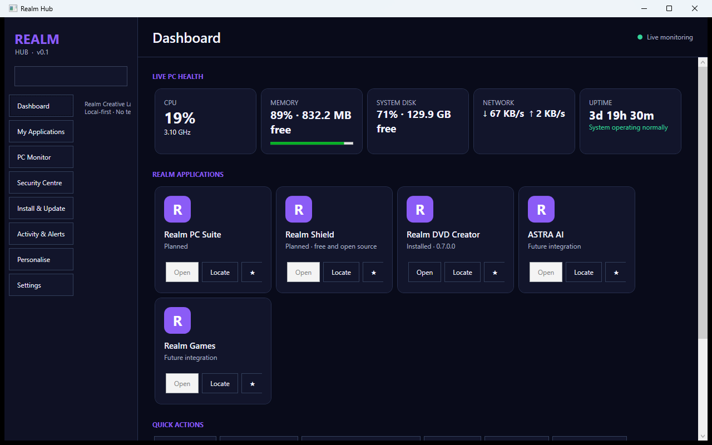 | 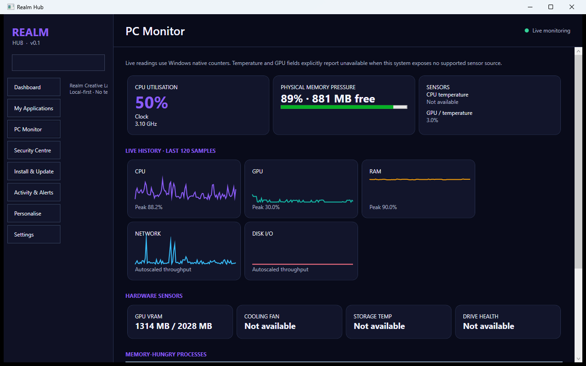 |

| Realm application launcher | Desktop widget |
| --- | --- |
| 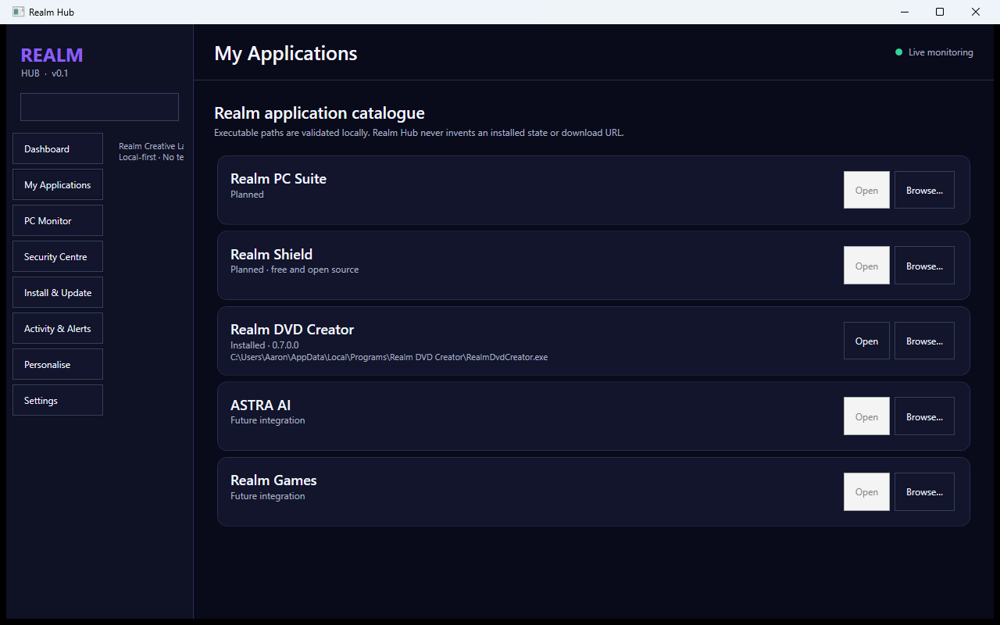 | 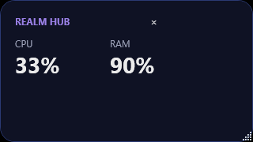 |

| Realm Neon | Realm Professional |
| --- | --- |
|  | 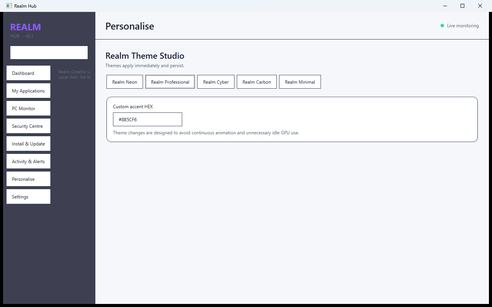 |

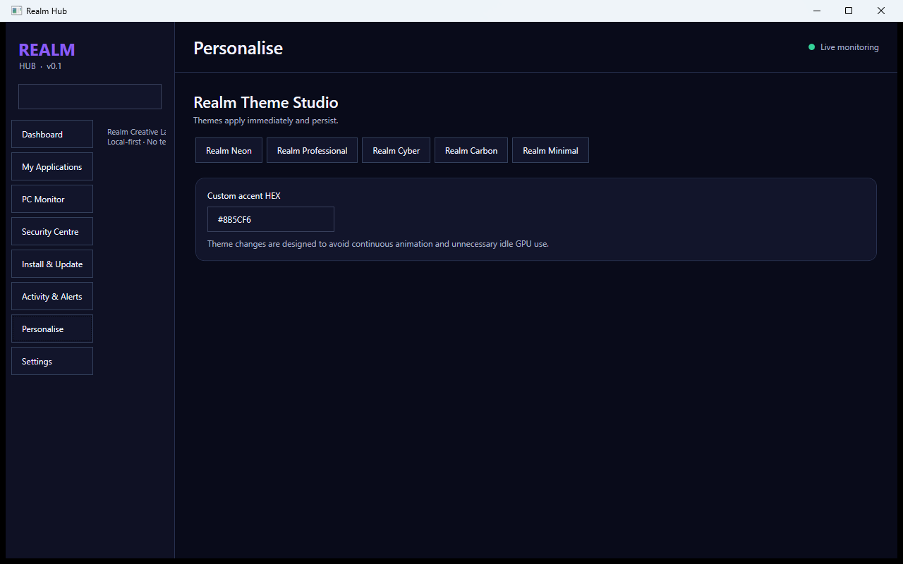

### Realm Hub v0.2.0 development screenshots

These are real Windows captures from the isolated v0.2.0 acceptance build. Smart Cleaner used only a neutral disposable test folder; the images contain no personal filenames, user-profile paths, settings, credentials or private source. The Storage page was verified separately, but its hardware screenshot is intentionally not published because it contains local drive labels.

| Responsive Smart Cleaner | Full cleanup review |
| --- | --- |
| 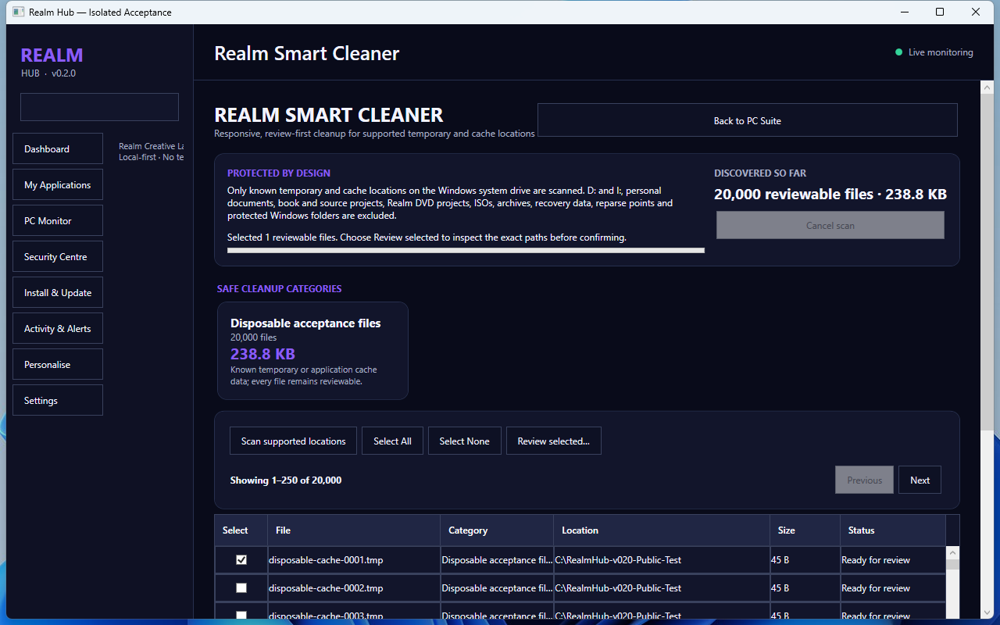 | 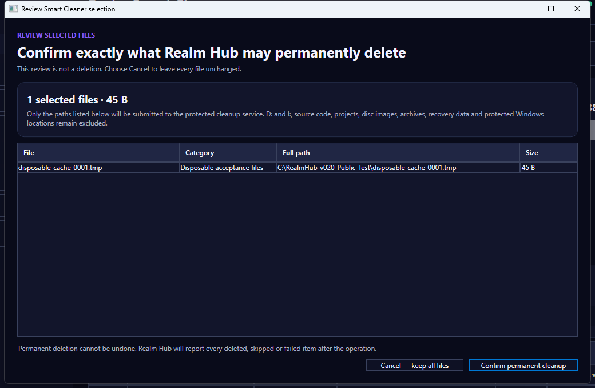 |

| Safe locked-file result | Genuine Windows driver inventory |
| --- | --- |
| 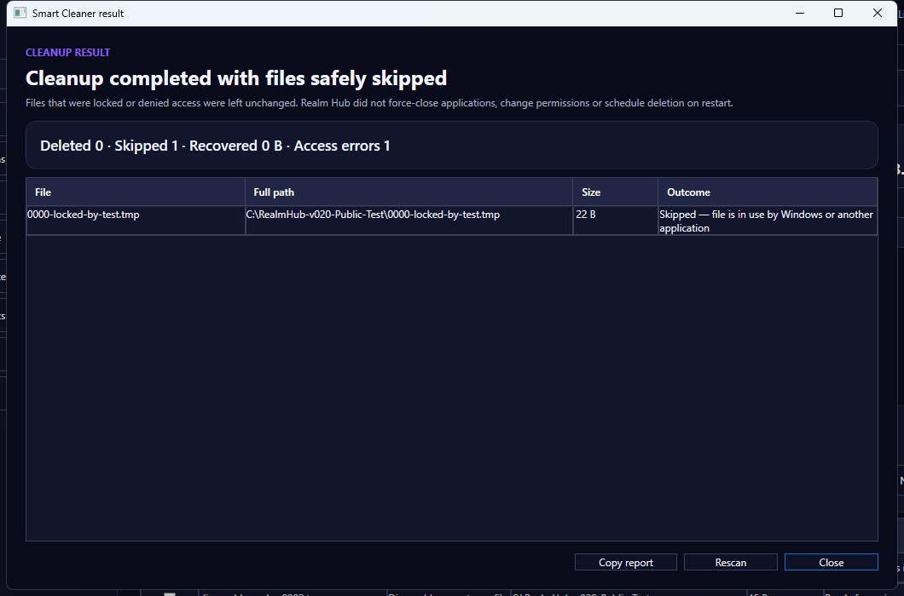 | 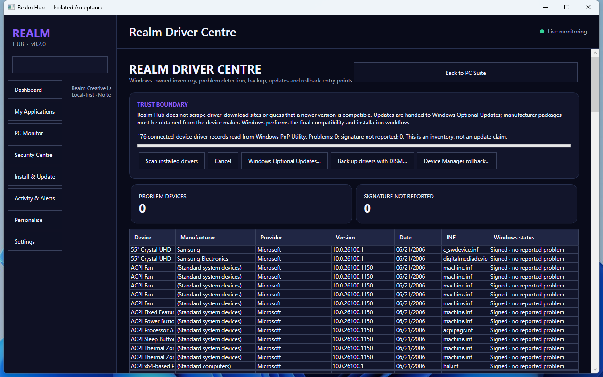 |

### 🎮 Willowbrook Games
**Status: In Development**

Our game development projects, including the Willow Brook game world, focused on creating engaging interactive experiences.

### 🤖 ASTRA AI
**Status: In Development**

Our personal AI assistant project, designed to support intelligent automation, software development and connected digital workflows.

### 🛠️ Discord Bot
**Status: Private Development**

A custom Discord bot project, with further information to be shared as development progresses.

## 🧪 Development Updates

Projects featured here may still be experimental, under development or undergoing testing.

Public showcases do not necessarily include downloadable applications or publicly available source code.

## 🔐 Source Code and Availability

Some Realm Creative Labs projects are maintained in private repositories.

Public project information, screenshots and release announcements will be shared when ready.

## 🌐 Follow Our Progress

Follow this GitHub profile for future project updates, screenshots and development milestones.

**© 2026 Realm Creative Labs**

*Building the future, one project at a time.*
